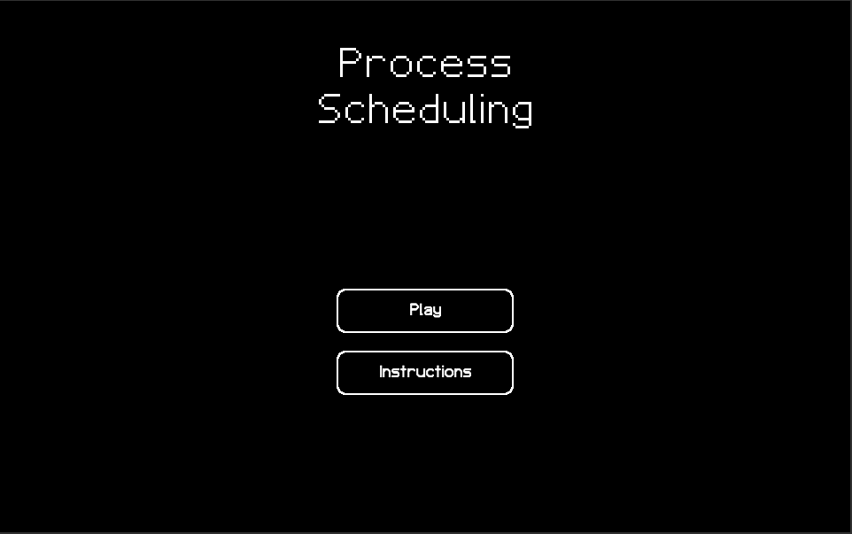

# Process Scheduling
[Japanese (日本語版)](./README.ja-JP.md)

Process Scheduling is a game where you assume the role of a process scheduler for an operating system, where you decide how to assign computer processes to CPUs for processing within a given amount of time. 
This game aims to give a basic idea of how the operating system manages the different programs that are run by the user.

This is a prototype of an idea that I had regarding turning the fundamental concept of process scheduling in operating systems into a simple game.

This game was made as an entry for [Finally Finish Something game jam (FFSjam) 2021](https://itch.io/jam/finally-finish-something-2021), which ran from January 1, 2021 - February 1, 2021.

This game was made using the [Unity](https://unity.com) game engine and C#.

You can play the game in a browser [here](https://jayzonty.itch.io/process-scheduling).
